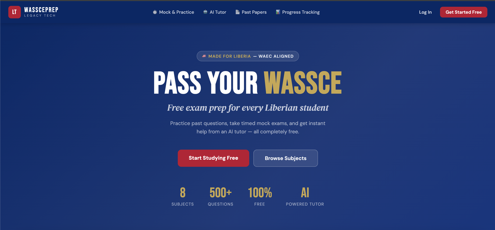
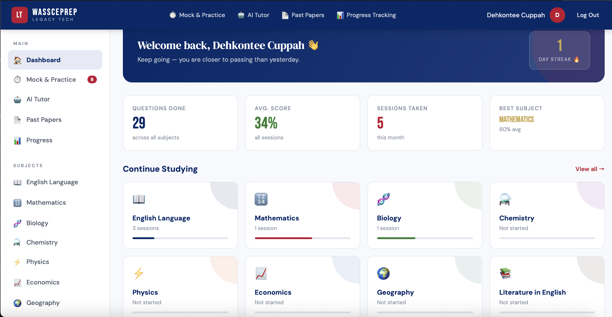
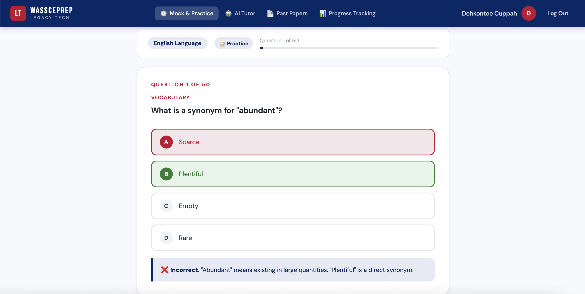
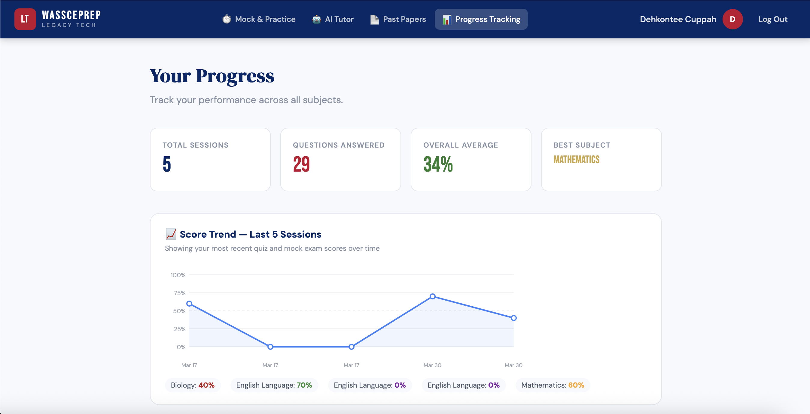

# WASSCEPrep

**Exam-prep app for Liberian students taking the WASSCE (West African Senior School Certificate Examination).** Personal project, in development. Source code is private; this page gives an overview.

## Features

- **Practice quizzes and mock exams** following the real WASSCE paper structure, with timers
- **8 subjects:** English Language, Mathematics, Biology, Chemistry, Physics, Economics, Geography and Literature in English
- **AI marking** of essay answers and an **AI tutor**, using the Anthropic Claude API
- **Progress tracking** with scores by subject and WAEC-style grading
- **Mobile-first design** that can be added to a phone's home screen, for students who mostly use phones

## Screenshots

| Dashboard | Practice quiz | Progress tracking |
|---|---|---|
|  |  |  |

## Architecture

- **Frontend:** React 18, Vite, React Router
- **Backend:** Supabase for authentication and the database; serverless functions for AI requests
- **AI:** Anthropic Claude API for essay marking and tutoring

## Tech stack

React · Vite · Supabase (PostgreSQL, Auth) · Serverless functions · Anthropic Claude API
